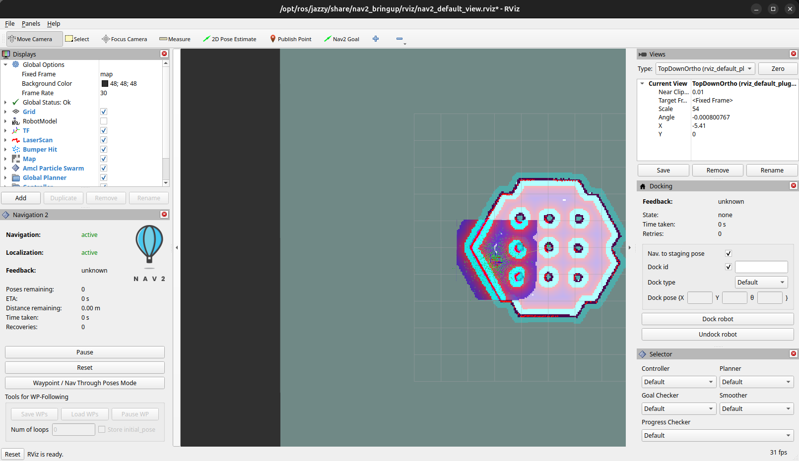
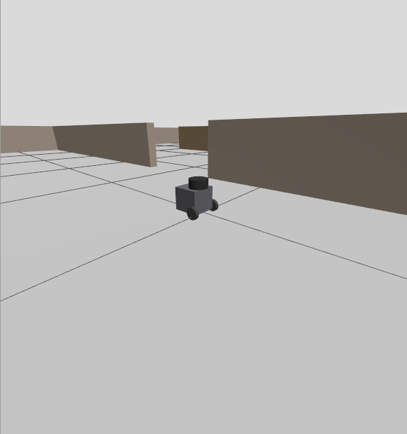
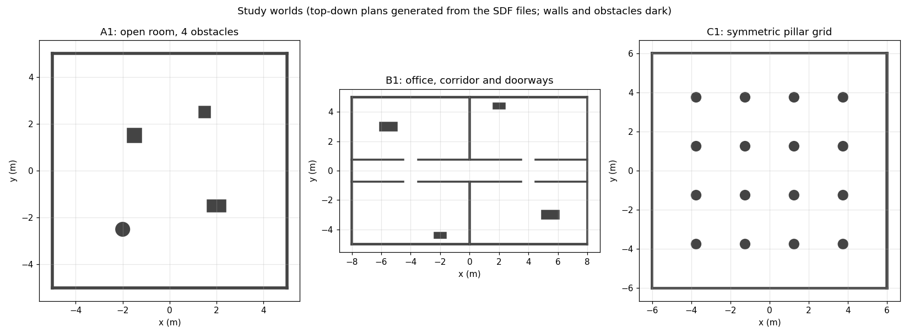
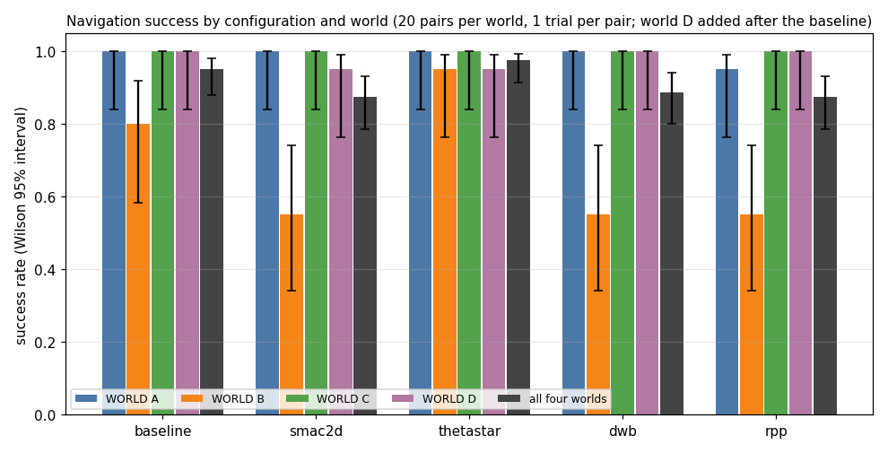
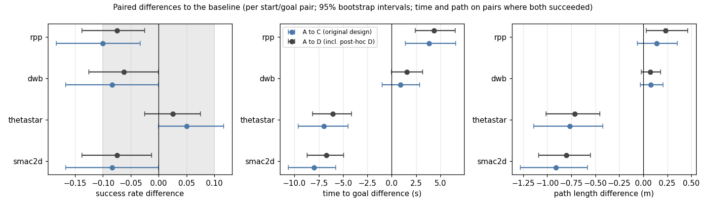

# ROS 2 Mobile Robot: SLAM, Localization and Navigation

**Status: Phase 4 of 7 (planner and controller comparison) complete; diagnosis of failures is next**

A simulated differential-drive robot that maps an unknown environment, localizes itself, and navigates to goals while avoiding obstacles, built on mature ROS 2 packages (SLAM Toolbox, AMCL, Nav2).

Part 2 of 3: follows [robust-computer-vision](https://github.com/jayesh518/robust-computer-vision) and feeds [autonomous-rescue-rover](https://github.com/jayesh518/autonomous-rescue-rover).

## Planned scope
- ROS 2 + Gazebo + RViz simulation, no hardware.
- Map building with SLAM Toolbox, localization with AMCL.
- Nav2 goal navigation and obstacle avoidance.
- At least one custom ROS 2 node (e.g. waypoint sequencing or recovery behaviour).
- Repeatable trials across maps and start/goal pairs.

## Metrics (reported only once measured)
Navigation success rate, collisions, time to goal, path length, recovery events, with number of trials and conditions stated.

## Structure
```
src/        ROS 2 packages and launch files
maps/       saved maps
docs/       report.md and diagrams/ (TF and architecture)
```

## Progress figures
One final screenshot per phase, with captions, in [docs/figures](docs/figures/README.md).







## Results so far
Baseline (shipped Nav2 defaults: NavFn planner, MPPI controller) against four variants that each change one component (Smac2D or Theta\* planner; DWB or Regulated Pure Pursuit controller): 400 simulated trials in four worlds, 20 start/goal pairs each, no collisions. Details, limits and the decision rule: [docs/results.md](docs/results.md); baseline alone: [docs/baseline.md](docs/baseline.md).

- Success was at or near 100% in the open room, the pillar grid and the dense-clutter world for every configuration; all differences are in the office world (baseline 16/20, Smac2D 11/20, Theta\* 19/20, DWB 11/20, RPP 11/20). By the pre-registered rule no variant changed success clearly, except Regulated Pure Pursuit in the original three worlds (-10 points, exactly at the threshold).
- Smac2D and Theta\* found routes about 7% shorter and 6 to 7 s faster than the baseline; Regulated Pure Pursuit was about 4 s slower.
- Diagnosis ([docs/diagnosis.md](docs/diagnosis.md), exploratory): most office failures are the global planner flipping between a short route through a wall that is missing from the saved map and the long route through a doorway; the robot oscillates until the time limit. With unknown space forbidden the flips disappeared in all 8 test trials and 5 of the 6 failed pairs succeeded, but two pairs still failed for a reason not yet found. So the office differences between configurations are largely about behaviour with an incomplete map.
- Not yet done: the custom recovery behaviour and the hardware-matched check (Phase 6). Results are from simulation only.






## Notes
My contribution is configuration, integration, custom behaviours, experiments and interpretation, not a reimplementation of SLAM or Nav2.
