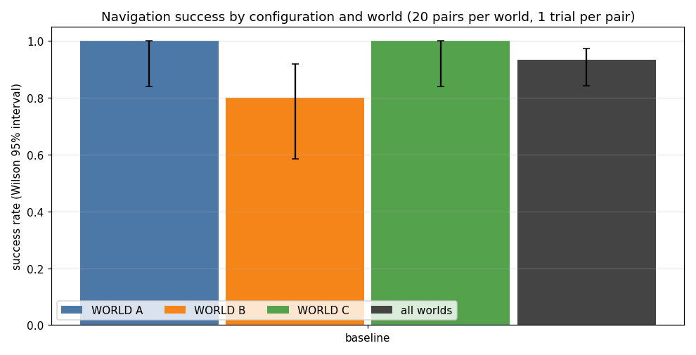

# ROS 2 Mobile Robot: SLAM, Localization and Navigation

**Status: Phase 3 of 7 (baseline) complete; the configuration comparison is next**

A simulated differential-drive robot that maps an unknown environment, localizes itself, and navigates to goals while avoiding obstacles, built on mature ROS 2 packages (SLAM Toolbox, AMCL, Nav2).

Part 2 of 3: follows [robust-computer-vision](https://github.com/jayesh518/robust-computer-vision) and feeds [autonomous-rescue-rover](https://github.com/jayesh518/autonomous-rescue-rover).

## Planned scope
- ROS 2 + Gazebo + RViz simulation, no hardware.
- Map building with SLAM Toolbox, localization with AMCL.
- Nav2 goal navigation and obstacle avoidance.
- At least one custom ROS 2 node (e.g. waypoint sequencing or recovery behaviour).
- Repeatable trials across maps and start/goal pairs.

## Metrics (reported only once measured)
Navigation success rate, collisions, time to goal, path length, recovery events, with number of trials and conditions stated.

## Structure
```
src/        ROS 2 packages and launch files
maps/       saved maps
docs/       report.md and diagrams/ (TF and architecture)
```

## Progress figures
One final screenshot per phase, with captions, in [docs/figures](docs/figures/README.md).


## Results so far
Baseline (shipped Nav2 defaults, 60 trials): 56 of 60 reached the goal (93%, 95% interval 0.84 to 0.97); world A 20/20, world B 16/20, world C 20/20; no collisions. Details, limits and the four failures: [docs/baseline.md](docs/baseline.md).



The comparison of planners, controllers and the custom recovery behaviour (Phase 4) has not been run yet.

## Notes
My contribution is configuration, integration, custom behaviours, experiments and interpretation, not a reimplementation of SLAM or Nav2.
