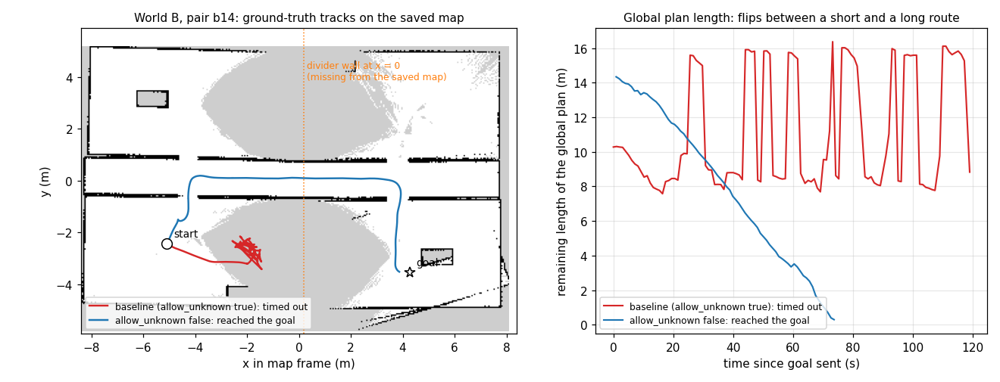

# Phase 5: diagnosis of the world-B failures

Status: done 2026-10-27 (gate). Scope was fixed before any diagnosis trial; the hypothesis test was fixed before its run.

## Question and status of the evidence
Why do trials fail in world B (office), and why do the configurations fail differently? Phase 4 left three observations (`docs/results.md`): smac2d mostly ends in Nav2 aborts, dwb and rpp coincide with large AMCL error, thetastar rarely fails. This phase is **exploratory and descriptive**: it explains individual failures from traces; it makes no new significance claims and does not change any Phase 4 number.

## What was already visible without new trials (Phase 4 CSVs)
All 32 world-B failures are long crossings of the office: every failed pair has a straight-line distance of 9.4 m or more and a baseline path of 14 to 21 m; no pair under 9 m ever failed in any configuration. Failures are pair-specific, not random: b02 failed in 5 of 5 configurations, b11 and b04 in 4 of 5, b09, b06 and b14 in 3.

## Method (fixed now)
- The trial runner gets an optional `--trace-dir`: a 5 Hz trace per trial (ground-truth pose, AMCL pose in world frame, commanded velocity, nearest LiDAR return, collision-monitor state) and an event log (behaviour-tree status changes with their times, each new global plan with its length and end point). Off by default; with it off the runner is unchanged.
- Re-runs: every world-B trial that failed in Phase 4 (32 trials: baseline 4, smac2d 9, dwb 9, rpp 9, thetastar 1) plus, for contrast, the baseline on b06, b14, b15 and b16 (long pairs it solved). One trial per pair and configuration, session seed 12 (as in Phase 4), real-time factor 1, same maps and configs.
- Outputs go to `results/diagnosis/` (CSV rows and `traces/`), never to `results/trials/`, so the Phase 4 tables cannot change. Re-run outcomes are reported next to the Phase 4 outcome; because Nav2 and AMCL are not seedable, a re-run may differ from the original (that is itself information about how deterministic a failure is).
- Reading the traces: where the robot stops or loops (position against the map and walls), which behaviour-tree node was active, whether the plan end moved, AMCL error over time, nearest obstacle at the moment of the stall, collision-monitor state.
- Traces (small CSVs) are committed; rosbags are not used.

## Hypothesis test fixed before running (2026-10-27)
Observation from the 36 traces (see Findings): plan flips happen near the unmapped divider wall at x = 0 and the saved map is unknown there, while every planner ships `allow_unknown: true`. Hypothesis **HU**: the flips (and most failures) are caused by the planner routing through unknown map cells. Diagnostic configuration `diag_known` = baseline with ONE change, `planner_server.GridBased.allow_unknown: false` (`scripts/make_nav2_configs.py`, `configs/nav2/diag_known.yaml`). Run on the 6 pairs the baseline failed (b02, b04, b06, b11, b14, b20) and 2 it solved (b15, b16), one trial each, session seed 12.
- **If HU is right:** plan flips near the divider disappear (0 to 1 per trial) and most of the 6 failed pairs succeed.
- **If HU is wrong:** flips and failures persist; the cause lies elsewhere (e.g. costmap marking and clearing, or controller behaviour).
- A caveat that applies either way: with unknown space forbidden, goals or routes inside unmapped patches become unreachable, so a new kind of failure is possible; this is a diagnostic, not a recommendation to change the baseline.

## Findings (2026-10-27; exploratory, 36 diagnosis trials plus 8 test trials, one trial per pair and configuration)

**1. The failures in world B are mostly plan flipping at an unmapped wall.**
- The saved SLAM Toolbox map of world B has large unknown areas in the middle of the four rooms (grey in the figure), and the divider wall at x = 0 is missing from it: the mapping tour never observed those parts (3.5 m LiDAR). Every Phase 4 planner ships with `allow_unknown: true`, so the planner sees a short route (8 to 11 m remaining) straight through the unmapped wall and a long one (about 16 m) through the doorway at x = -4 or x = 4.
- With the LiDAR inside 2.5 m of the wall, the obstacle layer marks it and the plan jumps to the long route; the robot turns back; away from the wall the mark no longer counts and the plan jumps back. The traces show this repeating until the 120 s limit (timeout) or until recoveries and aborts. The mechanism is read from the plan-length series and the tracks; we did not dump the costmap.
- Counts (`results/diagnosis/trace_summary.csv`; a flip is a jump of more than 3 m in the global plan length between consecutive plans): 10 of the 36 re-runs succeeded, and 9 of those 10 had no flips (the tenth, regulated pure pursuit on b09, had 6). Of the 26 failures, 25 had 3 or more flips (3 to 21); the exception is smac2d on b16, an abort 1.3 m from the goal (see 3). 248 of the 290 flips happen within 0.8 to 3.2 m of the divider in the rooms; 30 of the other 42 are regulated pure pursuit flips in the doorway at x = -4.
- The same four pairs fail again and again (b02, b04, b11, b14): they are the long crossings from a west room to an east room (or back), which is why short pairs never fail.

**2. This probably explains part of the Phase 4 localisation observation, but that is not tested.** AMCL error is higher near the divider (mean 0.87 m against 0.41 m elsewhere, pooled over all trace samples; samples are not independent) where the robot looks at a wall the map does not contain. dwb and rpp oscillated more, so their larger AMCL error is consistent with the time spent there rather than with a property of the controllers themselves. We did not separate the two.

**3. The Phase 4 failure labels are not stable.** In Phase 4, 8 of 9 smac2d failures were Nav2 aborts; in the re-runs only 2 of 6 smac2d failures were aborts (the others timed out). Of the 32 Phase 4 failures, 24 failed again and 8 succeeded (smac2d 3, dwb 3, rpp 1, thetastar 1). Of the 4 baseline controls (solved in Phase 4), 2 failed (b06, b14; their Phase 4 times, 103 s and 101 s, were already close to the limit). Nav2 and AMCL are not seedable, so one pair can end either way; the pair-level difficulty is stable, the label of the failure is not. The "smac2d mostly aborts" description in `docs/results.md` should therefore not be read as a property of the planner.

**4. Test of the hypothesis (`diag_known`, prediction written above before the run).**
- Result: 0 plan flips in all 8 trials (3 to 21 in each failed baseline re-run). Of the 6 pairs the baseline failed, 5 succeeded (b02, b04, b11, b14, b20: 69 to 92 s); b06 failed. Of the 2 control pairs, b15 succeeded and b16 failed.
- So the flip mechanism is supported (prediction: flips disappear, most failed pairs succeed). The prediction "cause lies elsewhere if flips persist" is not triggered.
- **Not resolved:** the 2 remaining failures (b06 and b16, both Nav2 aborts after 6 recoveries) are a different failure: the planner repeatedly fails to find a plan from the doorway to the goal inside the room (about 15 and 14 planner failures at two goals in the log), although the saved map is free along those routes. The smac2d re-runs of the same two pairs also aborted. With `allow_unknown: false` a new failure appeared on a pair the baseline solved (b16); we did not find its cause (the costmap was not dumped).
- This is a diagnostic only. It is not a recommended change, it is one trial per pair, and the hypothesis came from the baseline traces of the same pairs, so the test is not independent of them.

## What this means for the study
- Phase 4 numbers are unchanged. The world-B differences between configurations are largely differences in how each configuration behaves with an incomplete map (unknown space inside the rooms), not clean planner or controller differences. This is a limit of the maps (protocol change log (f) already noted unobserved patches) and must be stated in the report.
- Why theta* did best in world B (19/20) is **not explained**: it also ships `allow_unknown: true`; one diagnosis trial (b02, no flips, succeeded) is not enough.
- H2 (a recovery behaviour raises success) now has a concrete target: a recovery that detects plan flipping (several large plan-length jumps in a short time) is a more meaningful test than a generic one; proposed for Phase 6, to be fixed in the protocol before any trial.

## Limits of this phase
Re-runs, not the original trials; one trial per cell; Nav2 and AMCL not seedable; the 3 m flip threshold is a choice (a threshold of 2 or 5 m would change counts slightly, not the pattern); the costmap was never dumped, so the exact cell values the planner saw are inferred from the map file and the plan series; no significance tests, by design.
